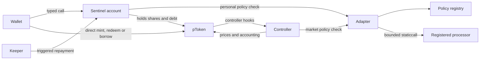

# Peridot Sentinel architecture

Each market has its own controller and two cloned Peridot ERC-20 lending books. The factory fixes the collateral asset, debt asset, oracle, rate model, registry, adapter and pToken implementation for a deployment. Creation assigns an owner and immutable limits. Debt liquidity must be supplied before the owner can activate borrowing. The approved pair and fixtures in the development deployment carry no real value.

The compiler converts a versioned spec into a stateless NAND program. The market template evaluates a numeric post-action LTV threshold, freshness and an optional borrow reserve condition. The account template evaluates its own LTV threshold, freshness and operation mask. Registration binds program identity and immutable config hash to a chain and registry. Both policy checks consume the same post-action projection from the controller. The controller also enforces the protocol's independent solvency, liquidity and cap checks.

Sentinel owns its supplied pTokens and outstanding debt. Borrowing and redemption settle into the account. The owner can withdraw idle underlying to their own address. An operator grant binds one account, one isolated market, a debt-denominated cumulative budget, a mask and an expiry. Accounts expose typed methods. Automation uses the same account contract as the owner's manual interactions.

## Running the keeper

Build `packages/chain-config` and `services/keeper` with their npm build scripts after installing the workspace dependencies. Invoke `npm --prefix services/keeper run once` with KEEPER_CHAIN_ID, KEEPER_RPC, KEEPER_ACCOUNT and KEEPER_OPERATOR. This records an actual eth_call simulation. Add `-- --execute` to send an eligible repayment. Chain 31337 uses an unlocked loopback Anvil operator. Chain 1952 requires a separately funded operator with its own KEEPER_TESTNET_OPERATOR_KEY in the environment. The signer cannot be the testnet deployer or the account owner. KEEPER_MAX_FEE_WEI bounds estimated gas cost including headroom.

Each invocation reads the account's factory registration, trigger and stored LTV, then simulates the complete repayment including accrual and balance/allowance checks. Output is JSON lines. Each submitted transaction gets a journal record under services/keeper/.state before broadcast and an execution record with the mined event after confirmation. A later invocation checks any outstanding hash before signing. After an interrupted or indeterminate broadcast, reconcile the recorded hash and nonce against the node before clearing a stranded pending record. On local Anvil, journal directories also include the node instance ID so a chain reset cannot mix old receipts with the new chain. Public testnet journals keep their existing layout.

### Long-running monitor

Run `npm --prefix services/keeper run serve` with the same account/operator settings used for `once`. Simulation is the default. `npm --prefix services/keeper run serve -- --execute` enables settlement after simulation. KEEPER_MANIFEST can select a repo-relative manifest from a rehearsal. KEEPER_INTERVAL_MS sets the delay between completed cycles (default 30000, minimum 1000). KEEPER_MAX_RETRIES controls extra attempts on unexpected RPC or worker failures (default 2, range 0–3). Short exponential backoff is capped at the polling interval. Simulation denials, fee-budget skips and disabled triggers wait for the next interval. One cycle runs at a time. Each worker shares the operator's SQLite reservation with the one-shot CLI.

The service checks pending hashes before proposing new writes. A mined revert pauses execution and keeps the status and activity endpoints available for inspection. Review the receipt and restart the process to resume polling. A send with uncertain broadcast status remains reserved until its receipt or manual reconciliation. SIGINT and SIGTERM stop scheduling and allow an in-flight receipt check to finish. A restarted process reads the same durable journal.

GET /v1/status reports the current phase, attempts and timestamps. GET /v1/activity?limit=50 returns recent keeper attempts and mined outcomes for the configured scope, including simulation failures and fee-budget skips. By default these are served at `http://127.0.0.1:8787`. KEEPER_PORT and KEEPER_HOST configure the listen address. The browser read service exposes public operation fields and accepts GET only. A deployed frontend can consume it through an HTTPS read proxy. Addresses in the response identify the account and operator. The local instance ID distinguishes unforked and fork replay records across resets. Event-log queries, actual field names, caps and receipt semantics are specified in [INTERFACES v1.2](coordination/INTERFACES.md).

For a public testnet keeper supply KEEPER_TESTNET_OPERATOR_KEY only in the keeper process environment. Set KEEPER_OPERATOR to its public address, distinct from the deployer and Sentinel owner. The designated testnet operator is `0x2c7E78e47deBC84eFac28D336f98d54b4c1FCE88`. It needs test OKB for gas and an on-chain repay grant for the account. A wallet, registrar and deployment script have no need for its signing key.

## Deployment evidence

The deployment manifest is under packages/chain-config/deployments and the ABIs come from contracts/out. The code check verifies the chain and deployed code before a client enables writes. The on-chain development reference processor supports only the 20-input stateless policy subset. See TAPEOUT_INTEGRATION.md for sponsor mainnet read and fork evidence. The production release requires its own contracts, governance configuration, tests and approval.

## Sentinel Connect and external execution

The v2 account owns its Peridot books and idle tokens. Its typed lending adapter resolves the controller's approved books. Its swap adapter pins one router, pool, pair and fee tier. Sentinel Circuits evaluates the user's minimum output against a separate fresh quote before settlement. The frontend discovers v2 through a separate manifest. The M4 v1 manifest is the authority for the original accounts and keeper. [Expansion wire contract](coordination/INTERFACES_V2.md)

The optional server-side OnchainOS estimate runs with `node services/onchainos/quote.mjs WOKB 1000000000000000000`. It requests an informational WOKB/USDC quote on 196 and returns a fixed schema of assets and raw amounts. Configure OKX_API_KEY, OKX_API_SECRET and OKX_API_PASSPHRASE privately on the server. On November 26 the anonymous trade quote required a key. The separate market-price endpoint offered an x402 payment challenge. Credentialed quotes await approved access. [OKX API authentication](https://web3.okx.com/onchainos/dev-docs/home/api-access-and-usage) · [Market price API](https://web3.okx.com/onchainos/dev-docs-v5/dex-api/dex-market-price) · [Unauthenticated probe responses](../evidence/session5-onchainos)

A separate MCP client can exercise the seven-step agent-directed repayment demo over stdio on chain 1952. Read the v1 account and positions, inspect policy and authorization, request an OKX quote, simulate and propose, execute the authorized repayment, simulate a denied operator borrow, then read the canonical receipt and updated grant. The quote is informational and carries its own availability and chain. The process uses a dedicated operator key inherited via the environment. [Sentinel Connect setup](../services/mcp/README.md) · [SDK types and usage](../packages/sentinel-sdk/README.md)

## Transaction gas on X Layer

The keeper and Connect reserve the estimate plus 25% and 30,000 gas for auto-repay. Both compare the **padded limit** against the operator's fee budget and available gas balance before signing. The M4 deploy/ops path and v2 deployer reserve roughly one-third plus 30,000 gas above an estimate. Studio's local smoke reserves 30% plus 25,000 gas. Fable uses 30% on wallet estimates. Nested calls, changes in utilization and intervening blocks can change execution cost. Record gas used from the receipt; gas limit is a ceiling. Intentional testnet denials use an explicit limit and a separately decoded contract error.

## Public activity history

The indexer starts at the M4 factory deployment and discovers its markets, books and accounts from confirmed creation logs. It also loads the public expansion and vault manifests. Refresh the committed snapshot with `node services/indexer/refresh.mjs` every 15 minutes during demos and after a demo has 12 successor blocks. Each RPC request covers up to 100 blocks. The snapshot records its scanned range, terminal hash, confirmation depth and remaining gap. A client checks the terminal hash before merging a later head scan. Reverted transactions leave no events. Their separate evidence includes the mined receipt and error replay. Keeper attempts that ended before broadcast are available from the keeper activity endpoint. [Snapshot schema and refresh options](../services/indexer/README.md) · [Historical public snapshot](../packages/chain-config/activity/1952.json)

The restricted Connect v2 demo uses the swap-only D9 grant on one public 1952 account. A separate signer validates the exact proposal, reserves the nonce on the shared keeper/Connect lane, broadcasts once and checks the canonical receipt against actual balances, allowances and remaining grant. The model process connects over a one-use local MCP socket. The campaign permits one scoped swap and one deliberate one-unit denied borrow on the valueless testnet profile. [Tools, limits and transcript verifier](../services/mcp-v2/README.md)
