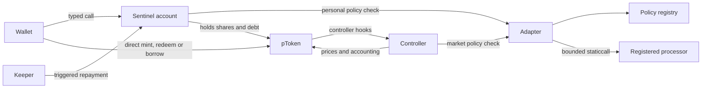

# Peridot Markets development architecture

Each market has its own controller and two cloned Peridot ERC-20 lending books. The factory fixes the collateral asset, debt asset, oracle, rate model, registry, adapter and pToken implementation for a deployment. Creation assigns an owner and immutable limits. Debt liquidity must be supplied before the owner can activate borrowing. The approved pair and fixtures in the development deployment carry no real value.

The compiler converts a versioned spec into a stateless NAND program. The market template evaluates a numeric post-action LTV threshold, freshness and an optional borrow reserve condition. The account template evaluates its own LTV threshold, freshness and operation mask. Registration binds program identity and immutable config hash to a chain and registry. Both policy checks consume the same post-action projection from the controller. The controller also enforces the protocol's independent solvency, liquidity and cap checks.

Sentinel owns its supplied pTokens and outstanding debt. Borrowing and redemption settle into the account. The owner can withdraw idle underlying to their own address. An operator grant binds one account, one isolated market, a debt-denominated cumulative budget, a mask and an expiry. Accounts expose typed methods. Automation uses the same account contract as the owner's manual interactions.

## Running the keeper

Build `packages/chain-config` and `services/keeper` with their npm build scripts after installing the workspace dependencies. Invoke `npm --prefix services/keeper run once` with KEEPER_CHAIN_ID, KEEPER_RPC, KEEPER_ACCOUNT and KEEPER_OPERATOR. This records an actual eth_call simulation. Add `-- --execute` to send an eligible repayment. Chain 31337 uses an unlocked loopback Anvil operator. Chain 1952 requires a separately funded operator with its own KEEPER_TESTNET_OPERATOR_KEY in the environment. The signer cannot be the testnet deployer or the account owner. KEEPER_MAX_FEE_WEI bounds estimated gas cost including headroom.

Each invocation reads the account's factory registration, trigger and stored LTV, then simulates the complete repayment including accrual and balance/allowance checks. Output is JSON lines. Each submitted transaction gets a journal record under services/keeper/.state before broadcast and an execution record with the mined event after confirmation. A later invocation checks any outstanding hash before signing. After an interrupted or indeterminate broadcast, reconcile the recorded hash and nonce against the node before clearing a stranded pending record. Schedule the one-shot command externally if periodic monitoring is desired.

## Deployment evidence

The deployment manifest is under packages/chain-config/deployments and the ABIs come from contracts/out. The code check verifies the chain and deployed code before a client enables writes. The on-chain development reference processor supports only the 20-input stateless policy subset. See TAPEOUT_INTEGRATION.md for sponsor mainnet read and fork evidence. The production release requires its own contracts, governance configuration, tests and approval.
